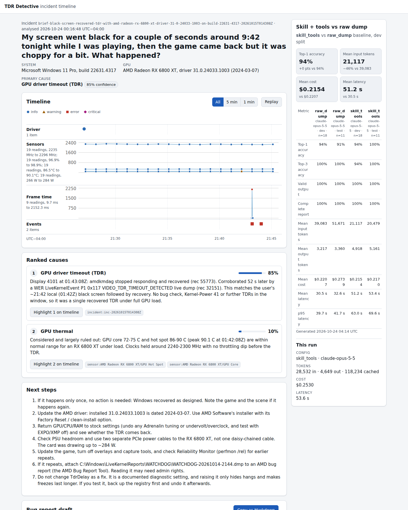

# TDR Detective

[](https://github.com/MAXIMUSSCORP/tdr-detective/actions/workflows/ci.yml)

A read-only Windows stability triage agent. Ask it *"why did my screen go black at 9:42?"* and it:

1. pulls display-driver timeouts (TDRs), live dumps, bug checks, WHEA and Kernel-Power events, the driver inventory, sensors and process, memory and disk state through a read-only MCP server;
2. correlates the evidence on one timeline using a packaged Agent Skill (the triage runbook);
3. returns a ranked root cause, next steps and a draft bug report with every field filled in.

It is vendor-neutral and AMD-aware: `amdkmdag`, `nvlddmkm` and `igfx*` signatures sit in one table, and sensors come from LibreHardwareMonitor, `nvidia-smi` or the Windows performance counters. The project's claims are measured, not asserted: an eval harness compares the skill against a raw-log-dump baseline on accuracy, tokens, cost and latency.



## Architecture

```
Claude Code / VS Code Copilot / Claude Agent SDK (tdr-detective CLI, eval runner)
        │ MCP (stdio)                              │ loads
        ▼                                          ▼
 pc-diag MCP server (Python, FastMCP 4)      .claude/skills/pc-stability-triage/
   system_info · list_tdr_incidents            SKILL.md (runbook, decision rules, guardrails)
   query_events · process_snapshot             reference/  bugcheck_table.md, tdr_checklist.md
   sensor_snapshot · driver_inventory          scripts/    compress_events.py (run, never read)
   dxdiag_summary · describe_collection
        │ PowerShell/CIM (fixed scripts)  or  replay directory
        ▼
 Windows Event Log, CIM, LibreHardwareMonitor, nvidia-smi, dxdiag

 tdr-detective ask --post ──► Express + SQLite API ──► React incident timeline
 evals/ (29 labelled cases, scorer, runners) · pytest · Jest/Vitest · GitHub Actions (windows + ubuntu)
```

| Component | Path | What it does |
|---|---|---|
| MCP server | `src/pc_diag_mcp/` | Eight read-only tools. A live collector runs fixed `.ps1` scripts; a replay collector serves recorded or synthetic scenarios. |
| Agent Skill | `.claude/skills/pc-stability-triage/` | Triage runbook with progressive disclosure. Reference files load only when needed, and the event compressor keeps raw logs out of the model's context. |
| Agent runner and CLI | `src/tdr_agent/` | `tdr-detective ask` runs the skill and the tools on the Claude Agent SDK, behind a deny-by-default guardrail. |
| Eval harness | `evals/` | 27 synthetic cases plus 2 recorded from a real laptop, a scorer, the `raw_dump` and `skill_tools` runners, and a cost-guarded run CLI. |
| Incident timeline | `timeline/` | Express 5 + better-sqlite3 API and a React 19 + Vite + recharts viewer. |

## Guardrails

- **Read-only toward the system.** Collectors only run `Get-*`/CIM queries and `dxdiag`. They never touch the registry, settings, services or drivers, and never elevate.
- **No injection path into PowerShell.** Scripts are fixed files in the package and parameters arrive as JSON on stdin. Event filters are built with an XML library from validated arguments. Executables resolve only from fixed system locations, never from `PATH`.
- **Untrusted text is labelled.** Event messages, driver names, sensor labels and process names are sanitized: control, invisible and Unicode-tag characters are stripped and the length is capped. Every result is marked `untrusted_text` so the agent treats it as data.
- **The agent cannot act.** `run_triage` allows only the eight pc-diag tools, the skill, `Read` inside the skill folder, and `Bash` limited to the compressor reading the server's own temp files. Everything else is denied by both a permission callback and a hook, and the run refuses to start if project settings widen permissions.
- **You see what it gathers first.** `describe_collection(tool)` returns the exact script and parameters a tool will run.
- **Replays, not real crashes.** Demos and evals replay recorded or synthetic event data. Nothing forces a real TDR.

## Quickstart

**Requirements:** Windows 10/11 (WSL2 also works, through `powershell.exe` interop), Python 3.12+, [uv](https://docs.astral.sh/uv/), Node 22.12+ for the timeline, and [Claude Code](https://code.claude.com) for interactive use. `tdr-detective ask` and the evals also need `ANTHROPIC_API_KEY`. On native Windows the Agent SDK uses the installed Claude Code CLI.

```bash
git clone https://github.com/MAXIMUSSCORP/tdr-detective.git
cd tdr-detective
uv sync --extra agent
```

### Use it in Claude Code

Open the folder in Claude Code and approve the `pc-diag` server from `.mcp.json`. The skill loads from `.claude/skills/`. Then ask in plain language:

```
why did my screen go black at 9:42 tonight?
```

To try it without a crash of your own, point the server at a replay before starting Claude Code:

```powershell
$env:PC_DIAG_REPLAY = "evals\scenarios\syn-026"   # PowerShell
claude
```

```bash
PC_DIAG_REPLAY=evals/scenarios/syn-026 claude      # bash / WSL
```

VS Code Copilot gets the same server from `.vscode/mcp.json`.

### Command line

```bash
uv run tdr-detective ask "My screen went black around 9:42 tonight while gaming" \
    --replay evals/scenarios/syn-026          # omit --replay to triage this machine
```

It prints the ranked causes, next steps, a Markdown bug report and the run's tokens and cost. Add `--json` for machine-readable output, or `--post http://127.0.0.1:4173` to send the incident to the timeline.

### Incident timeline

```bash
cd timeline
npm ci
npm run build && npm start    # http://127.0.0.1:4173
npm run seed                  # optional: a synthetic demo incident
```

`npm run dev` runs the API and the Vite dev server (http://127.0.0.1:5173) with hot reload. The API binds to `127.0.0.1` and checks Host and Origin headers. Set `TDR_EVAL_SUMMARY` to point the side panel at another `summary.json`.

### Record your own incident

```bash
uv run python -m pc_diag_mcp.record capture my-crash --start 2026-10-05T23:30:00Z --end 2026-10-06T00:30:00Z
uv run python -m pc_diag_mcp.record scrub fixtures/raw/my-crash evals/scenarios/rec-my-crash
```

`capture` writes to the git-ignored `fixtures/raw/`. `scrub` replaces host and user names, profile paths, SIDs, MAC and IP addresses, UNC paths and emails. It fails closed if anything still matches. Review the output before you share it, because Wi-Fi and device names can slip through.

## Evaluation

Both configurations use `claude-opus-5-5` at medium effort, with no model fallback, on the same 29 cases: 18 dev and 11 held-out test, with all 9 root-cause categories, AMD, NVIDIA and Intel drivers, and red herrings.

- **`raw_dump`** puts the whole scenario (every event, sensor, driver and process record) in a single request. Its prompt has the output contract and one line per category, but no runbook. A test fails the build if the prompt borrows any text, event ID or stop code from the skill.
- **`skill_tools`** is the agent: the skill plus the MCP tools reading the same scenario through the replay collector.

Measured on 2026-10-24 ([rows](evals/results/), [summary](evals/results/summary.json)):

| Config | Split | Top-1 | Top-3 | Uncached input tokens (mean) | Output tokens (mean) | Cost (mean) | Latency (mean) |
|---|---|---|---|---|---|---|---|
| raw_dump | dev (18) | 94.4% | 100% | 39,083 | 3,217 | $0.221 | 30.5 s |
| raw_dump | test (11) | 90.9% | 100% | 51,671 | 3,360 | $0.274 | 32.6 s |
| skill_tools | dev (18) | 94.4% | 94.4% | 21,117 | 4,918 | $0.215 | 51.2 s |
| skill_tools | test (11) | 100% | 100% | 20,479 | 5,161 | $0.217 | 53.4 s |

What the numbers say:

- **Accuracy is a tie.** Over all 29 cases, `skill_tools` is right on 28 at top-1 and `raw_dump` on 27. With 11 test cases, one case moves a rate by 9 points, so read the test gap as noise.
- **The skill holds cost flat while the raw dump grows with the log.** `skill_tools` reads about 21k uncached input tokens whatever the log size. It also reads about 90k tokens of cached Claude Code harness context, billed at the cache rate and included in its cost. By the raw log's size:

  | Raw log size | Cases | raw_dump | skill_tools | Difference |
  |---|---|---|---|---|
  | under 30k tokens | 16 | $0.144 | $0.195 | +35% |
  | 30k–60k tokens | 6 | $0.258 | $0.224 | −13% |
  | over 60k tokens | 7 | $0.448 | $0.258 | −42% |

- **The agent is slower.** Tool round trips make it about 1.7× slower (52 s vs 31 s mean).

Reproduce it (the full run cost about $13):

```bash
uv run python -m evals.run --config raw_dump --split all --dry-run    # token counts, no model calls
uv run python -m evals.run --config raw_dump --split all --max-cost-usd 11
uv run python -m evals.run --config skill_tools --split all --max-cost-usd 10
uv run python -m evals.report                                          # table + summary.json
```

## What failed

- **The first agent run measured a harness bug.** Replay scenarios have their own "current time", but no tool exposed it. The agent resolved "tonight" against the real date, found empty logs and answered `insufficient_evidence`: 66.7% dev and 72.7% test top-1 ([rows](evals/results/superseded/)). The fix added `now` to `system_info`, which is information the baseline already had in its input, and the agent config was re-run once. The runbook wasn't changed to suit eval cases.
- **One case beats both configurations.** `syn-019` is frame-time stutter next to an unrelated live dump, with no crash; the correct answer is `insufficient_evidence`. Both configurations blamed the GPU driver.
- **On small logs the skill costs more.** Below about 30k tokens of raw log, the harness overhead outweighs the savings.
- **Synthetic data has limits.** The background-noise rates are documented estimates, not fitted to real fleets. Some event message texts are paraphrased, though provider names and IDs are real.
- **AMD paths are tested on synthetic data only.** The development laptop has Intel and NVIDIA GPUs. The two recorded cases come from that laptop.
- **Paid evals ran on WSL2.** Native Windows runs the full test suite in CI (windows-latest, Python 3.12 and 3.14), but the agent's eval runs used the Linux build of the Agent SDK.
- **Not built yet:** live frame-time capture with PresentMon (frame times exist only in replays), AMD ADLX metrics, and pairing with a WinDbg MCP server for dump analysis. VS Code Copilot is configured but not yet tested end to end.
- **Some sources depend on the machine.** `C:\Windows\LiveKernelReports` may need admin rights. LibreHardwareMonitor sensors need its web server turned on. The meaning of `nvlddmkm` event 14 is not publicly documented.

## Related work

- [WinDbg MCP](https://devblogs.microsoft.com/performance-diagnostics/introducing-windbg-mcp-debug-with-natural-language-grounded-in-evidence/) (Microsoft, 2026) and [svnscha/mcp-windbg](https://github.com/svnscha/mcp-windbg) cover crash-dump analysis. TDR Detective works one layer up: it correlates event, driver, sensor and process evidence across sources and leaves dump debugging to those tools.

## Development

```bash
uv run pytest                                  # Python tests (live Windows smoke tests run when powershell.exe exists)
uv run ruff check && uv run ruff format --check && uv run mypy
uv run python -m pc_diag_mcp.schema --check    # Incident JSON Schema matches the models
uv run python -m evals.generate --check        # synthetic scenarios are reproducible
cd timeline && npm test && npm run lint && npm run typecheck && npm run build
```

## License

[MIT](LICENSE)
